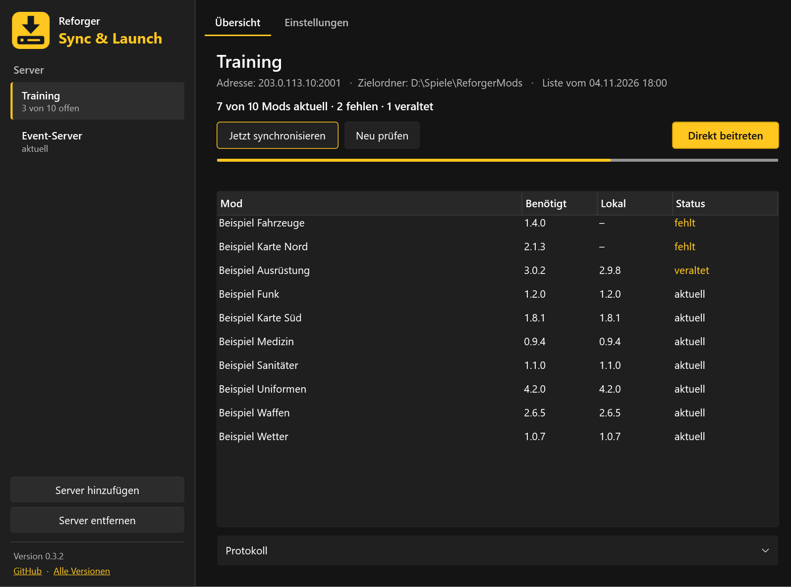
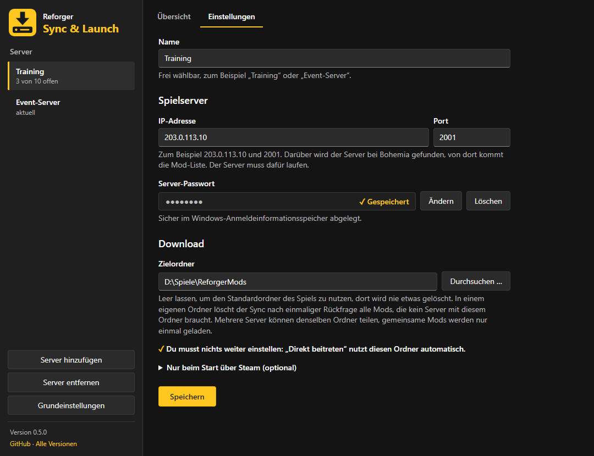
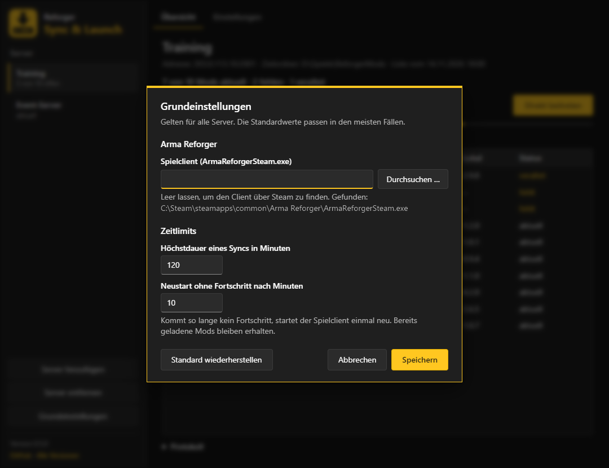
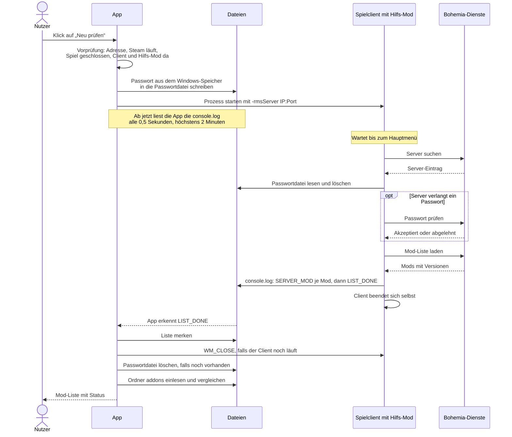
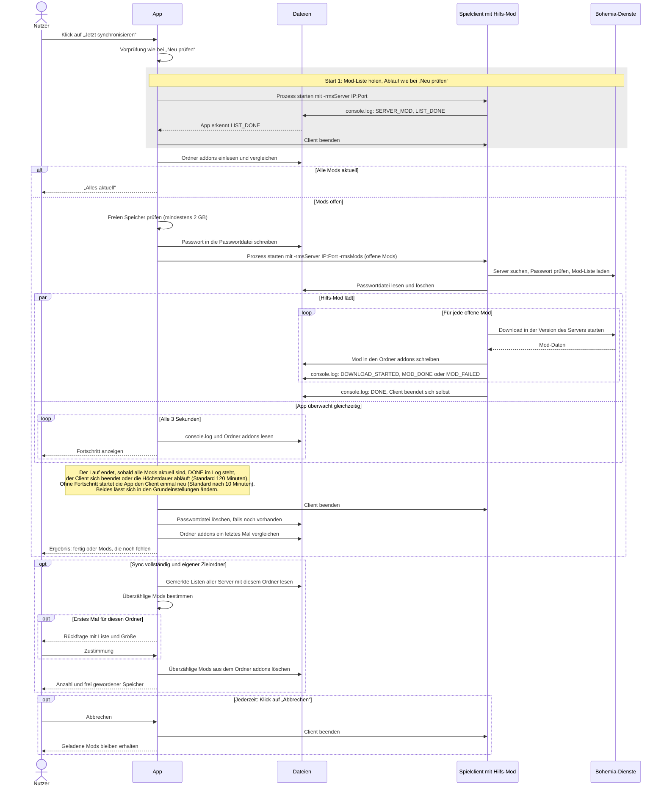
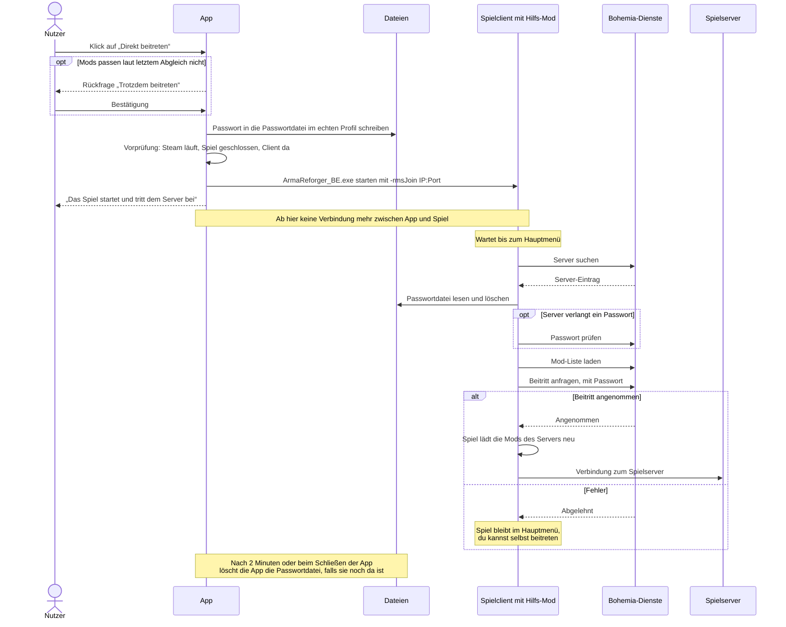

# Reforger Sync & Launch

**Sync & Launch** lädt die Mods eines Arma-Reforger-Servers vorab herunter, damit du beim Beitritt nicht mehr warten musst.



## Wofür ist das?

Beim Beitritt zu einem Server lädt Arma Reforger fehlende Mods erst dann, und du wartest im Ladebildschirm. Mit Sync & Launch erledigst du das vorher, zum Beispiel am Abend vor einem Event. Beim Beitritt ist dann schon alles da.

## Was macht es?

- **Mods abgleichen:** Holt die Mod-Liste aus dem Eintrag des Servers bei Bohemia und zeigt, welche Mods fehlen, veraltet oder aktuell sind.
- **Mods laden:** Bringt alle Mods auf die Version des Servers. Das Spielfenster bleibt dabei ausgeblendet.
- **Direkt beitreten:** Startet das Spiel und verbindet dich mit dem Server.
- **Mehrere Server verwalten:** Jeder Server hat seine eigene Adresse, sein Passwort und seinen Zielordner. Weitere Server legst du links mit **Server hinzufügen** an.

Den Download übernimmt dein installierter Arma-Reforger-Client mit einer kleinen Hilfs-Mod, die dem Paket beiliegt. Das Tool spricht nicht selbst mit dem Bohemia Workshop.

## Voraussetzungen

- Windows 10 oder 11, 64 Bit
- Steam läuft, Arma Reforger ist installiert
- IP-Adresse, Port und gegebenenfalls Passwort des Servers
- Zum Prüfen und Synchronisieren muss der Server laufen, sonst wird sein Eintrag bei Bohemia nicht gefunden

## Installation

1. Die ZIP-Datei von der Seite [Releases](../../releases) herunterladen.
2. In einen festen Ordner entpacken, am besten `%LOCALAPPDATA%\Programs\ReforgerSyncLaunch` (in die Adresszeile des Explorers eingeben). Der Ordner `helper` muss neben der EXE bleiben.

   Nimm keinen Ordner direkt unter `C:\`, etwa `C:\Spiele`. Dort dürfen alle Benutzer des PCs Dateien ändern und könnten die App oder die Hilfs-Mod austauschen. Dein Benutzerordner ist nur für dich beschreibbar.
3. `ReforgerSyncLaunch.exe` starten.

Die Testversion ist nicht signiert, deshalb warnt Windows eventuell beim ersten Start. Klicke dann auf „Weitere Informationen“ und „Trotzdem ausführen“.

**Aktualisieren:** Deine Version steht in der Titelleiste und links unten in der App, der Link **Alle Versionen** führt zu den Releases. Schließe die App und entpacke die neue ZIP-Datei in denselben Ordner. Einstellungen, Passwörter und Mods bleiben erhalten.

## Was muss ich einstellen?

Alles stellst du in der App ein, Dateien musst du nicht bearbeiten.

### Server



Jeder Server wird im Reiter **Einstellungen** eingetragen. Weitere Server legst du links mit **Server hinzufügen** an.

| Feld | Bedeutung |
|---|---|
| **Name** | Frei wählbar, zum Beispiel „Training“ |
| **IP-Adresse** | IP des Spielservers, zum Beispiel `203.0.113.10`. Fügst du `IP:Port` am Stück ein, füllt die App beide Felder |
| **Port** | Port des Spielservers, zum Beispiel `2001`. Das Feld nimmt nur Ziffern an |
| **Server-Passwort** | Leer lassen, wenn der Server keines hat. Ein gespeichertes Passwort erscheint als Punkte mit „✓ Gespeichert“ und lässt sich über **Ändern** und **Löschen** bearbeiten |
| **Zielordner** | Wohin die Mods geladen werden. Leer lassen, um den Standardordner des Spiels zu nutzen |

Klicke danach auf **Speichern**. Dabei wird noch nicht geprüft, ob Adresse und Passwort stimmen, der Server darf also gerade offline sein. Das zeigt sich erst in der **Übersicht** mit **Neu prüfen** oder **Jetzt synchronisieren**. Beides braucht einen laufenden Server.

**Zielordner:** Die Mods liegen darin im Unterordner `addons`. Wähle den Ordner, der deinen vorhandenen `addons`-Ordner enthält, sonst wird alles neu geladen. Achtung: In einem eigenen Zielordner löscht der Sync alle Mods, die kein eingetragener Server mit diesem Ordner braucht, siehe [Gut zu wissen](#gut-zu-wissen).

**Start über Steam (optional):** Mit „Direkt beitreten“ musst du nichts weiter einstellen, das Spiel nutzt deinen Zielordner automatisch. Nur wenn du das Spiel direkt über Steam startest und einen eigenen Zielordner gewählt hast, klappe „Nur beim Start über Steam“ auf und kopiere den Text in die Startoptionen (Arma Reforger › Eigenschaften › Startoptionen). Sonst lädt das Spiel beim Beitritt alles erneut.

### Grundeinstellungen (optional)



Der Button **Grundeinstellungen** links unten gilt für alle Server. Die Standardwerte passen in den meisten Fällen, **Standard wiederherstellen** setzt sie zurück.

| Feld | Bedeutung | Standard |
|---|---|---|
| **Spielclient** | Pfad zu `ArmaReforgerSteam.exe`. Nur nötig, wenn die App das Spiel nicht über Steam findet. Darunter steht, welchen Client sie gefunden hat | leer, über Steam erkennen |
| **Höchstdauer eines Syncs** | Danach bricht der Sync ab, 10 bis 600 Minuten | 120 Minuten |
| **Neustart ohne Fortschritt** | Kommt so lange kein Fortschritt, startet der Spielclient einmal neu, ab 2 Minuten und kürzer als die Höchstdauer | 10 Minuten |

## Benutzung

1. Das Spiel schließen.
2. Optional in der **Übersicht** auf **Neu prüfen** klicken. Das holt nur die Mod-Liste und zeigt, was fehlt, ohne etwas herunterzuladen.
3. Auf **Jetzt synchronisieren** klicken. Das erste Mal kann das lange dauern. Während des Laufs wird daraus **Abbrechen**, bereits geladene Mods bleiben dabei erhalten.
4. Auf **Direkt beitreten** klicken, sobald alles aktuell ist.

Beim Schließen des Fensters wird die App beendet. Ein laufender Sync bricht dabei ab, vorher fragt die App nach. Das Spiel läuft nach „Direkt beitreten“ auch ohne die App weiter.

## Gut zu wissen

- **Versionen:** Ein Sync bringt Mods auf die Version des Servers, auch zurück auf eine ältere. Das gilt für den gewählten Zielordner. Wer auf anderen Servern andere Versionen braucht, nimmt einen eigenen Zielordner.
- **Exakter Abgleich:** Nach einem vollständigen Sync enthält ein eigener Zielordner nur noch die Mods, die mindestens ein eingetragener Server mit diesem Ordner braucht. Beim ersten Mal zeigt die App die Liste und fragt nach, danach löscht sie für diesen Ordner automatisch. Das Ergebnis steht im Protokoll.
    - Der Standardordner des Spiels bleibt unberührt, dort wird nie etwas gelöscht.
    - Fehlt für einen Server mit demselben Ordner die Mod-Liste, wird nichts gelöscht. Klicke dort einmal auf **Neu prüfen**. Es gilt die zuletzt geholte Liste jedes Servers.
    - Liegen im Ordner Mods von Servern, die nicht in der App eingetragen sind, gelten sie als überzählig. Nimm für solche Server einen eigenen Ordner oder trage sie ein.
    - Ordner ohne lesbare Mod-Angaben bleiben liegen.
- **Passwort:** Es liegt verschlüsselt im Windows-Anmeldeinformationsspeicher. Für den Abruf beim Server steht es kurz in einer temporären Datei, die danach sofort gelöscht wird. Änderst du die Server-Adresse, fragt die App, ob das Passwort auch für die neue Adresse gelten soll.
- **BattlEye:** Beim Spielstart kann Windows nach Administratorrechten fragen.
- **Lizenzen:** Die Mods stammen aus dem Arma Reforger Workshop. Für jede Mod gelten ihre Lizenz und die [Workshop-Bedingungen](https://reforger.armaplatform.com/workshop-terms) von Bohemia Interactive.

Dies ist kein offizielles Produkt von Bohemia Interactive.

## Probleme melden

Nenne deine Version (steht in der Titelleiste und links unten in der App), beschreibe, was du geklickt hast und was passiert ist, und schicke diese beiden Ordner mit. Darin steht kein Passwort, aber die Server-Adresse und dein Windows-Benutzername:

```
%LOCALAPPDATA%\ReforgerModSync\logs
%LOCALAPPDATA%\ReforgerModSync\clientlogs
```

Die App hebt die Protokolle der letzten 14 Tage und die Spiel-Logs der letzten 10 Läufe auf, ältere löscht sie selbst. Schicke die Ordner deshalb bald nach dem Problem.

## Entfernen

1. In der App jeden Server mit **Server entfernen** löschen. Dabei werden auch die gespeicherten Passwörter gelöscht.
2. Den Ordner der App löschen.
3. Optional auch `%APPDATA%\ReforgerModSync` und `%LOCALAPPDATA%\ReforgerModSync` löschen.

Die geladenen Mods bleiben erhalten.

## Abläufe und Schnittstellen

Die App spricht weder mit Bohemia noch mit dem Spielserver. Sie startet den Spielclient, und die Hilfs-Mod in diesem Client erledigt den Rest. App und Hilfs-Mod verständigen sich nur über Startparameter und Dateien:

| Richtung | Schnittstelle | Inhalt |
|---|---|---|
| App → Hilfs-Mod | Startparameter | `-rmsServer`, `-rmsMods` oder `-rmsJoin` sagen ihr, was zu tun ist. Ohne sie macht sie nichts |
| App → Hilfs-Mod | Datei `rms_server_password.txt` im Profilordner | Das Passwort. Die Hilfs-Mod löscht die Datei beim Lesen |
| Hilfs-Mod → App | `[RMS]`-Zeilen in der `console.log` des Clients | Fortschritt, Mod-Liste und Fehler |
| Spielclient → App | Ordner `addons` im Zielordner | Die App liest die Versionen der Mods auf der Festplatte und vergleicht sie |
| App → Spielclient | Fensternachricht `WM_CLOSE` | Beenden. Reagiert der Client nach 5 Sekunden nicht, beendet die App den Prozess |
| Spielclient → Bohemia | Schnittstellen des Spiels | Server suchen, Passwort prüfen, Mod-Liste laden, Mods laden, Beitritt anfragen |

### Neu prüfen

Holt nur die Mod-Liste. Der Client läuft ausgeblendet und verbindet sich nicht mit dem Spielserver.



Statt `LIST_DONE` kann die Hilfs-Mod auch `ROOM_NOT_FOUND`, `ROOM_PASSWORD_REQUIRED`, `ROOM_PASSWORD_REJECTED` oder einen anderen Fehler melden. Die App zeigt dann eine passende Meldung.

### Jetzt synchronisieren

Der Client startet zweimal: erst für die Mod-Liste, dann für den Download. Sind schon alle Mods aktuell, entfällt der zweite Start.



### Direkt beitreten

Hier läuft das Spiel normal: über den BattlEye-Starter, mit deinem echten Profil und sichtbar. Die App bekommt danach keine Rückmeldung mehr, sie liest bei diesem Ablauf keine Logzeilen.



## Entwicklung

Gebaut mit C#, .NET 10 und WPF. Benötigt wird das .NET 10 SDK unter Windows.

| Ordner | Inhalt |
|---|---|
| `src/ReforgerModSync.Core` | Die gesamte Logik: Abgleich, Startparameter, Logzeilen, Sync, Einstellungen, Passwörter |
| `src/ReforgerModSync.App` | Die Oberfläche (WPF), erzeugt `ReforgerSyncLaunch.exe` |
| `src/ReforgerModSync.Cli` | Konsole zum Testen: `status` und `sync [--server <Name>]` |
| `helper/ReforgerModSyncHelper` | Die Hilfs-Mod, die der Spielclient ungepackt lädt |
| `tests/ReforgerModSync.Core.Tests` | Tests für Core |

```powershell
dotnet build ReforgerModSync.slnx                                                  # App, CLI und Tests bauen
dotnet test ReforgerModSync.slnx                                                   # Tests
dotnet run --project src\ReforgerModSync.Cli -- status                             # Stand aller Server, ohne Spielstart
powershell -ExecutionPolicy Bypass -File scripts\build-package.ps1 -Version 0.4.0  # Paket bauen
```

Ein Tag wie `v0.4.0` baut das Paket über GitHub Actions und veröffentlicht es als Release. Die App zeigt dann genau diese Version an, lokale Builds melden `0.0.0-dev`. Versionen unter 1.0 erscheinen als Vorabversion.
