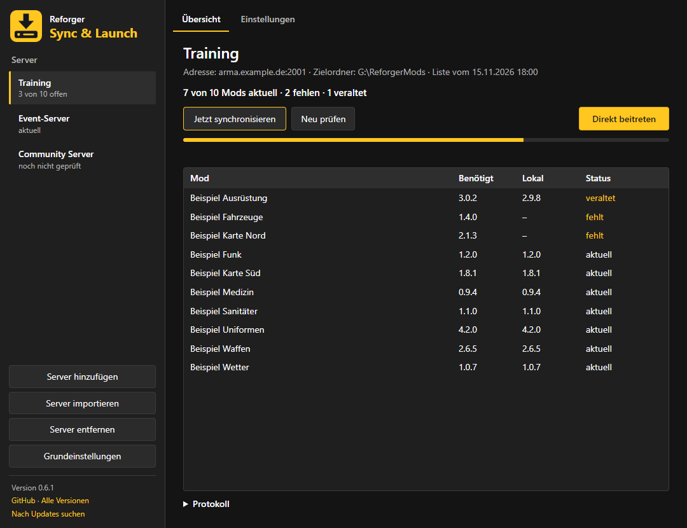
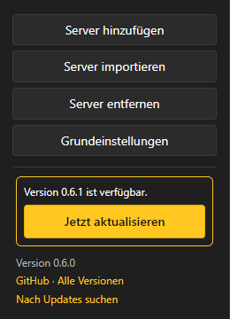
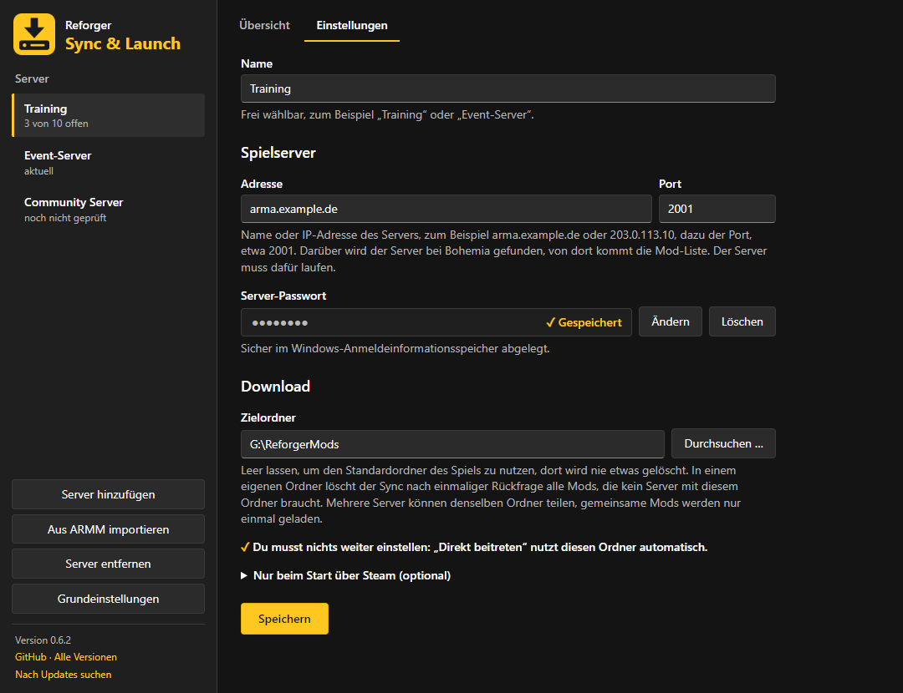
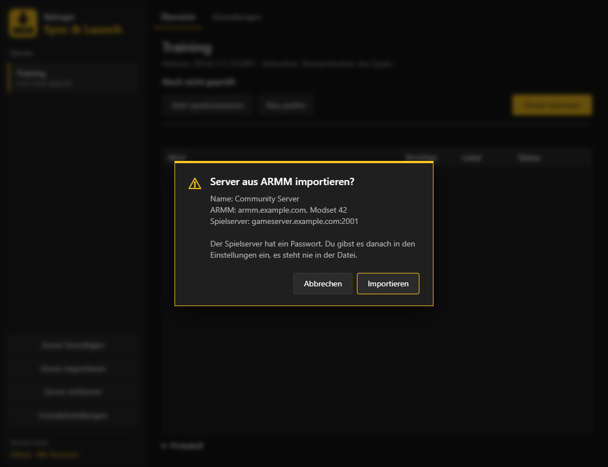
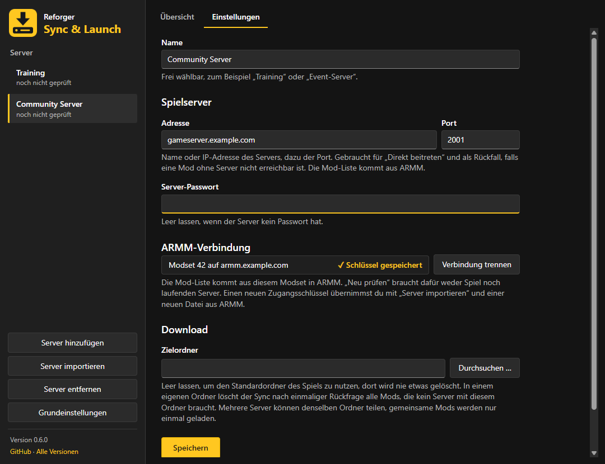
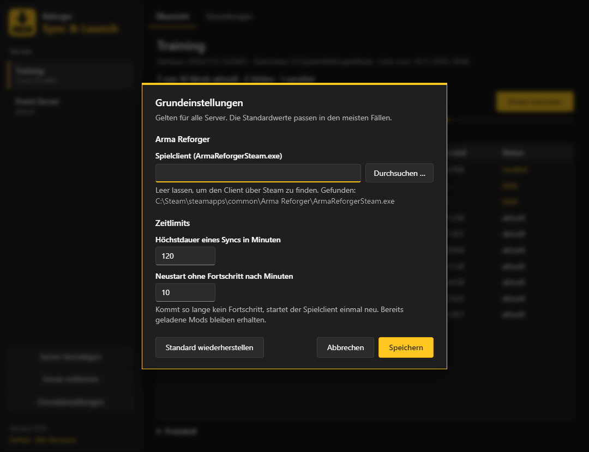
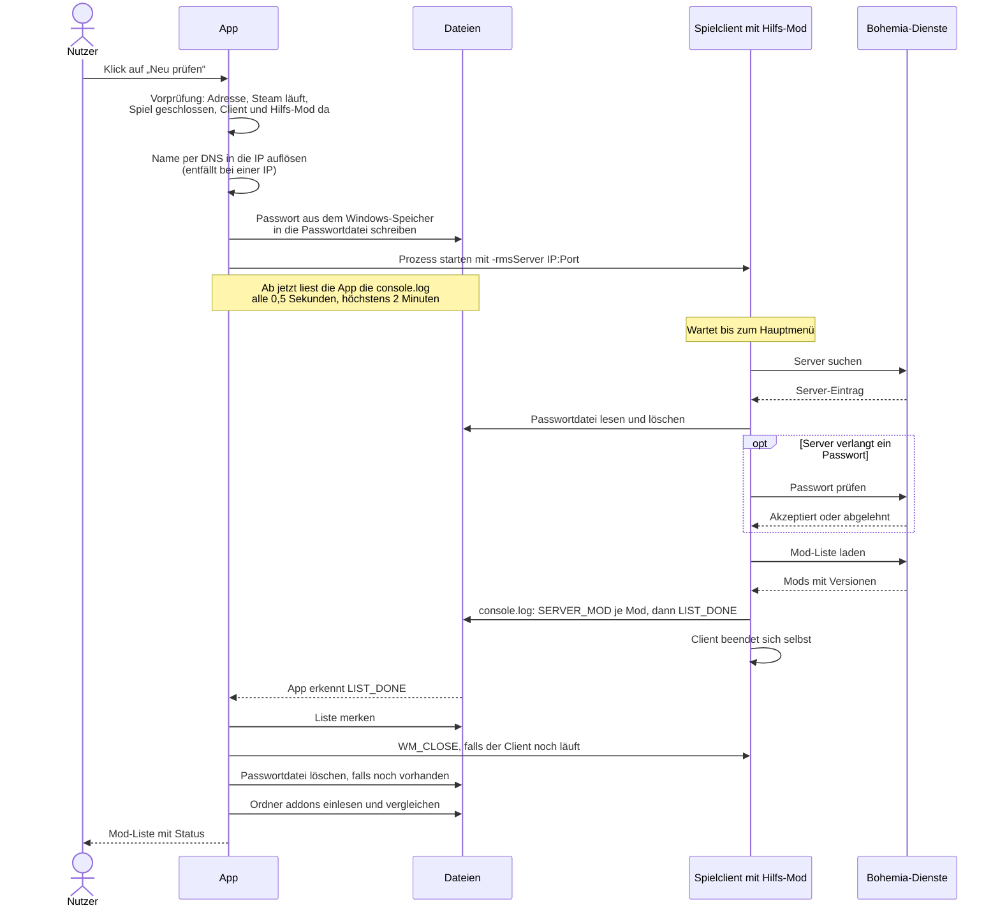
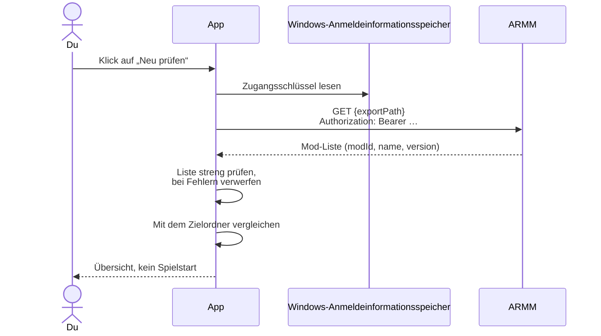
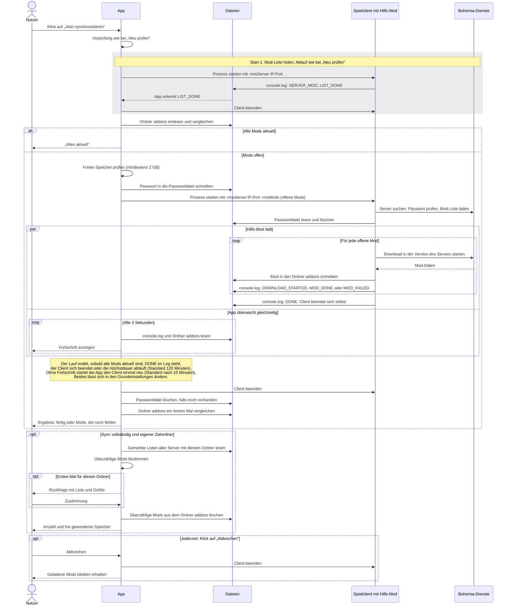
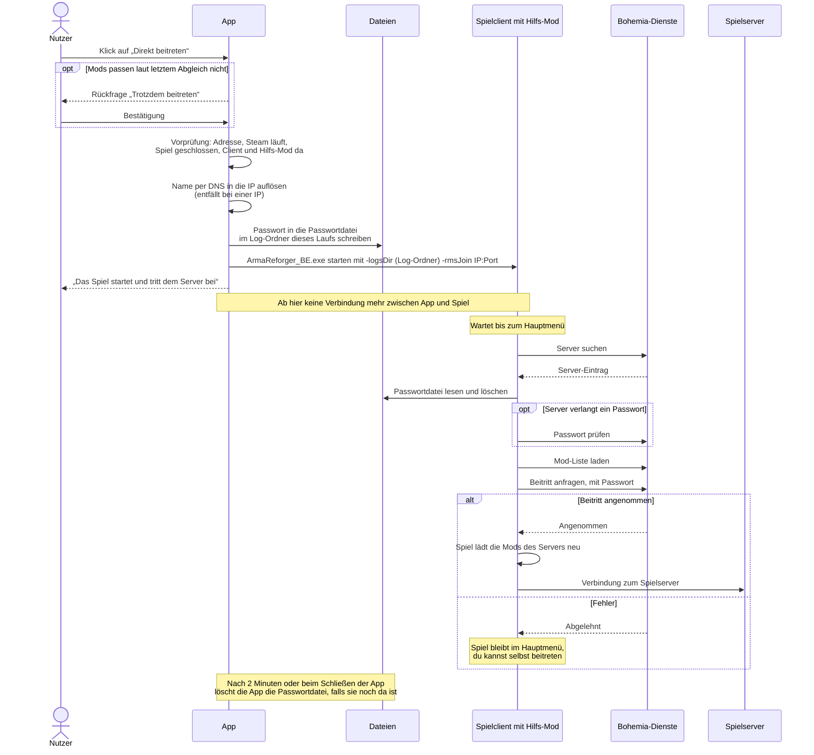

# Reforger Sync & Launch

**Sync & Launch** lädt die Mods eines Arma-Reforger-Servers vorab herunter, damit du beim Beitritt nicht mehr warten musst.



## Wofür ist das?

Beim Beitritt zu einem Server lädt Arma Reforger fehlende Mods erst dann, und du wartest im Ladebildschirm. Mit Sync & Launch erledigst du das vorher, zum Beispiel am Abend vor einem Event. Beim Beitritt ist dann schon alles da.

## Was macht es?

- **Mods abgleichen:** Holt die Mod-Liste aus dem Eintrag des Servers bei Bohemia und zeigt, welche Mods fehlen, veraltet oder aktuell sind.
- **Mods laden:** Bringt alle Mods auf die Version des Servers. Das Spielfenster bleibt dabei ausgeblendet.
- **Direkt beitreten:** Startet das Spiel und verbindet dich mit dem Server.
- **Mehrere Server verwalten:** Jeder Server hat seine eigene Adresse, sein Passwort und seinen Zielordner. Weitere Server legst du links mit **Server hinzufügen** an.
- **Server aus ARMM importieren:** Mit einer Importdatei (`.json`) aus ARMM legst du einen Server per Klick an. Seine Mod-Liste kommt dann direkt aus ARMM: Prüfen geht in Sekunden ohne Spielstart, und laden kannst du auch, wenn der Spielserver gerade aus ist.
- **Updates per Klick:** Die installierte App meldet neue Versionen selbst und aktualisiert sich nach Rückfrage.

Den Download übernimmt dein installierter Arma-Reforger-Client mit einer kleinen Hilfs-Mod, die dem Paket beiliegt. Das Tool spricht nicht selbst mit dem Bohemia Workshop.

## Voraussetzungen

- Windows 10 oder 11, 64 Bit
- Microsoft Edge WebView2 Runtime (unter Windows 11 dabei, unter Windows 10 meist mit Edge installiert; fehlt sie, meldet die App das beim Start)
- Steam läuft, Arma Reforger ist installiert
- Adresse (Name oder IP), Port und gegebenenfalls Passwort des Servers
- Zum Prüfen und Synchronisieren muss der Server laufen, sonst wird sein Eintrag bei Bohemia nicht gefunden. Bei einem aus ARMM importierten Server nicht, siehe [Server aus ARMM importieren](#server-aus-armm-importieren)

## Installation

1. `Reforger-Sync-Launch-<Version>-Setup.exe` von der Seite [Releases](../../releases) herunterladen.
2. Starten und dem Assistenten folgen. Administratorrechte braucht er nicht. Die App landet in `%LOCALAPPDATA%\Programs\ReforgerSyncLaunch` und im Startmenü.

Hast du bisher das ZIP in diesen Ordner entpackt, ersetzt der Installer diese Version. Einstellungen, Passwörter und Mods bleiben erhalten.

Die App ist nicht mit einem Zertifikat signiert, deshalb warnt Windows eventuell beim Start des Installers. Klicke dann auf „Weitere Informationen“ und „Trotzdem ausführen“.

**Aktualisieren:** Die App sucht beim Start nach einer neuen Version. Gibt es eine, steht links unten ein Hinweis. **Jetzt aktualisieren** lädt sie, installiert sie und startet die App neu, Einstellungen, Passwörter und Mods bleiben erhalten. Von Hand geht das über **Nach Updates suchen**. Ein Update wird nur installiert, wenn seine Signatur passt, ein verändertes Paket lehnt die App ab.



**Ohne Installation (ZIP):** Die ZIP-Datei in einen festen Ordner entpacken, am besten `%LOCALAPPDATA%\Programs\ReforgerSyncLaunch` (in die Adresszeile des Explorers eingeben), und `ReforgerSyncLaunch.exe` starten. Der Ordner `helper` muss neben der EXE bleiben. Nimm keinen Ordner direkt unter `C:\`, etwa `C:\Spiele`: Dort dürfen alle Benutzer des PCs Dateien ändern und könnten die App oder die Hilfs-Mod austauschen. Diese Variante meldet neue Versionen, aktualisiert sich aber nicht selbst. Zum Aktualisieren die App schließen und die neue ZIP-Datei in denselben Ordner entpacken.

**Prüfsumme (optional):** Jedes Release nennt die SHA-256-Prüfsummen von Installer und ZIP. In PowerShell zeigt `Get-FileHash .\<Dateiname>` den Wert deiner Datei, beide müssen übereinstimmen.

Deine Version steht in der Titelleiste und links unten in der App, der Link **Alle Versionen** führt zu den Releases.

## Was muss ich einstellen?

Alles stellst du in der App ein, Dateien musst du nicht bearbeiten.

### Server



Jeder Server wird im Reiter **Einstellungen** eingetragen. Weitere Server legst du links mit **Server hinzufügen** an.

| Feld | Bedeutung |
|---|---|
| **Name** | Frei wählbar, zum Beispiel „Training“ |
| **Adresse** | Name oder IP des Spielservers, zum Beispiel `arma.example.de` oder `203.0.113.10`. Fügst du `Adresse:Port` oder eine ganze URL ein, füllt die App beide Felder. Einen Namen löst die App bei jedem Prüfen, Synchronisieren und Beitreten neu in die IP auf, zieht der Server um, passt es also automatisch |
| **Port** | Port des Spielservers, zum Beispiel `2001`. Das Feld nimmt nur Ziffern an |
| **Server-Passwort** | Leer lassen, wenn der Server keines hat. Ein gespeichertes Passwort erscheint als Punkte mit „✓ Gespeichert“ und lässt sich über **Ändern** und **Löschen** bearbeiten |
| **Zielordner** | Wohin die Mods geladen werden. Leer lassen, um den Standardordner des Spiels zu nutzen |

Klicke danach auf **Speichern**. Dabei wird noch nicht geprüft, ob Adresse und Passwort stimmen, der Server darf also gerade offline sein. Das zeigt sich erst in der **Übersicht** mit **Neu prüfen** oder **Jetzt synchronisieren**. Beides braucht einen laufenden Server.

**Zielordner:** Die Mods liegen darin im Unterordner `addons`. Wähle den Ordner, der deinen vorhandenen `addons`-Ordner enthält, sonst wird alles neu geladen. Achtung: In einem eigenen Zielordner löscht der Sync alle Mods, die kein eingetragener Server mit diesem Ordner braucht, siehe [Gut zu wissen](#gut-zu-wissen).

**Start über Steam (optional):** Mit „Direkt beitreten“ musst du nichts weiter einstellen, das Spiel nutzt deinen Zielordner automatisch. Nur wenn du das Spiel direkt über Steam startest und einen eigenen Zielordner gewählt hast, klappe „Nur beim Start über Steam“ auf und kopiere den Text in die Startoptionen (Arma Reforger › Eigenschaften › Startoptionen). Sonst lädt das Spiel beim Beitritt alles erneut.

### Server aus ARMM importieren

Betreibt ihr ARMM, bekommst du dort eine Importdatei, eine `.json`-Datei, zum Beispiel `armm-sync.json`. Der Name ist egal. Klicke links auf **Aus ARMM importieren** und wähle die Datei. Die App zeigt dir, was sie anlegt: Name, ARMM-Adresse, Modset und Spielserver. Mit **Importieren** entsteht ein neuer Server, danach öffnen sich seine Einstellungen.



- **Passwort und Zielordner** trägst du danach wie gewohnt ein. Das Server-Passwort steht nie in der Importdatei.
- **Zugangsschlüssel:** Die Datei enthält deinen persönlichen Schlüssel für ARMM. Die App legt ihn verschlüsselt im Windows-Anmeldeinformationsspeicher ab, danach kannst du die Datei löschen. Gib sie nicht weiter.
- **Neuer Schlüssel:** Importierst du später eine neue Datei für dasselbe Modset, bekommt der vorhandene Server nur den neuen Schlüssel. Name, Adresse, Passwort und Zielordner bleiben.
- **Verbindung trennen:** In den Einstellungen unter **ARMM-Verbindung**. Der Server bleibt erhalten und holt seine Mod-Liste danach wieder vom laufenden Spielserver.



Ein importierter Server holt seine Mod-Liste per HTTPS aus ARMM. **Neu prüfen** startet dafür kein Spiel. **Jetzt synchronisieren** lädt die Mods auch, wenn der Spielserver aus ist: Die Hilfs-Mod findet sie im Workshop über ihren Namen oder über andere Mods des Modsets, die auf sie verweisen. Nur wenn eine Mod so nicht erreichbar ist, etwa weil der Server eine sehr alte Version verlangt, lädt die App sie über den Eintrag des laufenden Servers nach. Weicht die Liste aus ARMM dabei von der des Servers ab, warnt die App und löscht nichts.

### Grundeinstellungen (optional)



Der Button **Grundeinstellungen** links unten gilt für alle Server. Die Standardwerte passen in den meisten Fällen, **Standard wiederherstellen** setzt sie zurück.

| Feld | Bedeutung | Standard |
|---|---|---|
| **Spielclient** | Pfad zu `ArmaReforgerSteam.exe`. Nur nötig, wenn die App das Spiel nicht über Steam findet. Darunter steht, welchen Client sie gefunden hat | leer, über Steam erkennen |
| **Höchstdauer eines Syncs** | Danach bricht der Sync ab, 10 bis 600 Minuten | 120 Minuten |
| **Neustart ohne Fortschritt** | Kommt so lange kein Fortschritt, startet der Spielclient einmal neu, ab 2 Minuten und kürzer als die Höchstdauer | 10 Minuten |

## Benutzung

1. Das Spiel schließen.
2. Optional in der **Übersicht** auf **Neu prüfen** klicken. Das holt nur die Mod-Liste und zeigt, was fehlt, ohne etwas herunterzuladen.
3. Auf **Jetzt synchronisieren** klicken. Das erste Mal kann das lange dauern. Während des Laufs wird daraus **Abbrechen**, bereits geladene Mods bleiben dabei erhalten.
4. Auf **Direkt beitreten** klicken, sobald alles aktuell ist.

Beim Schließen des Fensters wird die App beendet. Ein laufender Sync bricht dabei ab, vorher fragt die App nach. Das Spiel läuft nach „Direkt beitreten“ auch ohne die App weiter.

## Gut zu wissen

- **Versionen:** Ein Sync bringt Mods auf die Version des Servers, auch zurück auf eine ältere. Das gilt für den gewählten Zielordner. Wer auf anderen Servern andere Versionen braucht, nimmt einen eigenen Zielordner.
- **Exakter Abgleich:** Nach einem vollständigen Sync enthält ein eigener Zielordner nur noch die Mods, die mindestens ein eingetragener Server mit diesem Ordner braucht. Beim ersten Mal zeigt die App die Liste und fragt nach, danach löscht sie für diesen Ordner automatisch. Das Ergebnis steht im Protokoll.
    - Der Standardordner des Spiels bleibt unberührt, dort wird nie etwas gelöscht.
    - Fehlt für einen Server mit demselben Ordner die Mod-Liste, wird nichts gelöscht. Klicke dort einmal auf **Neu prüfen**. Es gilt die zuletzt geholte Liste jedes Servers.
    - Liegen im Ordner Mods von Servern, die nicht in der App eingetragen sind, gelten sie als überzählig. Nimm für solche Server einen eigenen Ordner oder trage sie ein.
    - Ordner ohne lesbare Mod-Angaben bleiben liegen.
- **Passwort:** Es liegt verschlüsselt im Windows-Anmeldeinformationsspeicher. Für den Abruf beim Server steht es kurz in einer Datei im App-Ordner unter `%LOCALAPPDATA%`, nie in „Dokumente“ oder OneDrive. Die Hilfs-Mod löscht sie beim Lesen und gibt das Passwort nur an den Server mit genau der eingetragenen Adresse weiter, bei einem Namen an die IP, auf die er beim Start zeigt. Änderst du die Server-Adresse, fragt die App, ob das Passwort auch für die neue Adresse gelten soll.
- **BattlEye:** Beim Spielstart kann Windows nach Administratorrechten fragen.
- **Lizenzen:** Die Mods stammen aus dem Arma Reforger Workshop. Für jede Mod gelten ihre Lizenz und die [Workshop-Bedingungen](https://reforger.armaplatform.com/workshop-terms) von Bohemia Interactive.

Dies ist kein offizielles Produkt von Bohemia Interactive.

## Probleme melden

Nenne deine Version (steht in der Titelleiste und links unten in der App), beschreibe, was du geklickt hast und was passiert ist, und schicke diese beiden Ordner mit. Darin steht kein Passwort, aber die Server-Adresse und dein Windows-Benutzername:

```
%LOCALAPPDATA%\ReforgerModSync\logs
%LOCALAPPDATA%\ReforgerModSync\clientlogs
```

Die App hebt die Protokolle der letzten 14 Tage und die Spiel-Logs der letzten 10 Läufe auf, ältere löscht sie selbst. Schicke die Ordner deshalb bald nach dem Problem.

## Entfernen

**Installiert:** Windows-Einstellungen › Apps › Installierte Apps › Reforger Sync & Launch › Deinstallieren. Mit dem Haken **Lösche die Anwendungsdaten** entfernt das Deinstallationsprogramm auch alles, was die App gespeichert hat: Server und Einstellungen, gespeicherte Passwörter und ARMM-Schlüssel, Mod-Listen und Protokolle. Ohne Haken bleibt das erhalten, etwa für eine spätere Neuinstallation.

**ZIP:**
1. In der App jeden Server mit **Server entfernen** löschen. Dabei werden auch die gespeicherten Passwörter gelöscht.
2. Den Ordner der App löschen.
3. Optional auch `%APPDATA%\ReforgerModSync` und `%LOCALAPPDATA%\ReforgerModSync` löschen, dazu den Ordner `%LOCALAPPDATA%\de.morok.reforgersynclaunch` von WebView2.

Die geladenen Mods bleiben in beiden Fällen erhalten.

## Abläufe und Schnittstellen

Die App spricht weder mit Bohemia noch mit dem Spielserver. Sie startet den Spielclient, und die Hilfs-Mod in diesem Client erledigt den Rest. Ausnahmen: Bei einem aus ARMM importierten Server ruft die App die Mod-Liste per HTTPS aus ARMM ab, und für Updates fragt sie die Release-Seite auf GitHub. Sonst stellt sie keine Anfragen ins Netz. App und Hilfs-Mod verständigen sich nur über Startparameter und Dateien:

| Richtung | Schnittstelle | Inhalt |
|---|---|---|
| App → Hilfs-Mod | Startparameter | `-rmsServer`, `-rmsMods`, `-rmsModset` oder `-rmsJoin` sagen ihr, was zu tun ist. Ohne sie macht sie nichts |
| App → Hilfs-Mod | Datei `rms_modset.txt` im Profil des Clients (nur ARMM-Server) | Die Mods aus ARMM, je Zeile ID, Version, Name und ob sie zu laden ist. Nichts Geheimes, die App löscht sie nach dem Lauf |
| App → GitHub | HTTPS `GET …/releases/latest/download/latest.json` beim Start und über „Nach Updates suchen“, bei einem Update dann der darin genannte Installer | Versionsnummer, Signatur und Adresse des Installers. Installiert wird nur mit gültiger Signatur |
| App → ARMM | HTTPS `GET {baseUrl}{exportPath}` (beides aus der Importdatei) mit `Authorization: Bearer <Schlüssel>` (nur ARMM-Server) | Die Mod-Liste des Modsets. Nur `https`, keine Umleitung auf `http`, Zeitlimit 15 s |
| App → Hilfs-Mod | Datei `rms_server_password.txt` im Profil des Clients (Prüfen, Sync) oder im Log-Ordner des Laufs (Beitritt), beides unter `%LOCALAPPDATA%\ReforgerModSync` | Das Passwort. Die Hilfs-Mod löscht die Datei beim Lesen. Eine alte Datei ersetzt die App vor jedem Start |
| Hilfs-Mod → App | `[RMS]`-Zeilen in der `console.log` des Clients | Fortschritt, Mod-Liste und Fehler |
| Spielclient → App | Ordner `addons` im Zielordner | Die App liest die Versionen der Mods auf der Festplatte und vergleicht sie |
| App → Spielclient | Fensternachricht `WM_CLOSE` | Beenden. Reagiert der Client nach 5 Sekunden nicht, beendet die App den Prozess |
| Spielclient → Bohemia | Schnittstellen des Spiels | Server suchen, Passwort prüfen, Mod-Liste laden, Mods laden, Beitritt anfragen |

### Neu prüfen

Holt nur die Mod-Liste. Der Client läuft ausgeblendet und verbindet sich nicht mit dem Spielserver.



Statt `LIST_DONE` kann die Hilfs-Mod auch `ROOM_NOT_FOUND`, `ROOM_PASSWORD_REQUIRED`, `ROOM_PASSWORD_REJECTED` oder einen anderen Fehler melden. Die App zeigt dann eine passende Meldung.

### Neu prüfen bei einem ARMM-Server



### Jetzt synchronisieren

Der Client startet zweimal: erst für die Mod-Liste, dann für den Download. Sind schon alle Mods aktuell, entfällt der zweite Start.



### Direkt beitreten

Hier läuft das Spiel normal: über den BattlEye-Starter, mit deinem echten Profil und sichtbar. Nur die Logs dieser Sitzung landen unter `%LOCALAPPDATA%\ReforgerModSync\clientlogs`, dort liegt auch kurz die Passwortdatei. Die App bekommt danach keine Rückmeldung mehr, sie liest bei diesem Ablauf keine Logzeilen.



## Entwicklung

Gebaut mit Rust und Tauri 2, die Oberfläche mit TypeScript, HTML und CSS. Benötigt werden Rust (rustup mit MSVC, dazu die Visual Studio Build Tools mit C++) und Node.js.

| Ordner | Inhalt |
|---|---|
| `crates/rms-core` | Die gesamte Logik: Abgleich, Startparameter, Logzeilen, Sync, Einstellungen, Passwörter |
| `crates/rms-core/tests` | Tests, mit anonymisierten Beispiel-Logs unter `samples` |
| `crates/rms-cli` | Konsole: `status`, `check` und `sync [--server <Name>]` |
| `app/src-tauri` | Tauri-Backend, erzeugt `ReforgerSyncLaunch.exe` |
| `app/ui` | Oberfläche (TypeScript, HTML, CSS) |
| `helper/ReforgerModSyncHelper` | Die Hilfs-Mod, die der Spielclient ungepackt lädt |

```powershell
cargo test --workspace                                                               # Tests
cargo run -p rms-cli -- status                                                       # Stand aller Server, ohne Spielstart
cd app; npm ci; npx tauri dev                                                        # App mit Neuladen beim Ändern
powershell -ExecutionPolicy Bypass -File scripts\build-package.ps1 -Version 0.6.1    # Installer, latest.json und ZIP nach publish
```

Ein Tag wie `v0.6.1` baut Installer und ZIP über GitHub Actions und veröffentlicht sie als Release, ohne Vorabversion-Kennzeichen, damit die installierten Apps das Update finden. Der Signaturschlüssel für Updates kommt aus dem Secret `TAURI_SIGNING_PRIVATE_KEY`. Die Oberfläche darf nur die eigenen Befehle der App aufrufen, keine Datei-, Shell- oder Netzwerk-Plugins.

### Schnittstelle zu ARMM

**Importdatei** (`.json`, Name beliebig, z. B. `armm-sync.json`), erzeugt von ARMM:

```json
{
  "format": "armm-sync",
  "formatVersion": 1,
  "name": "Community Server",
  "armm": {
    "baseUrl": "https://armm.example.com",
    "modsetId": 42,
    "exportPath": "/api/sync/modsets/42/export",
    "accessKey": "…"
  },
  "gameServer": { "host": "gameserver.example.com", "port": 2001, "passwordRequired": true }
}
```

- `baseUrl`: nur `https://host` oder `https://host:port`, ohne Pfad. `modsetId`: positive Zahl, daran erkennt die App beim erneuten Import denselben Server. `accessKey`: Pflicht.
- `exportPath`: Pflicht. Pfad der Mod-Liste auf dem Host aus `baseUrl`, beginnt mit `/`, nur Buchstaben, Ziffern und `-._~/`, kein `..`, keine Parameter. ARMM legt ihn fest, die App hat keinen eigenen. Ein erneuter Import übernimmt einen geänderten Pfad.
- `gameServer` ist optional. Ein Feld `password` mit Wert lehnt die App ab, `null` ist erlaubt.
- Eine höhere `formatVersion` lehnt die App mit dem Hinweis ab, sie zu aktualisieren.

**Mod-Liste:** `GET {baseUrl}{exportPath}`, zum Beispiel `https://armm.example.com/api/sync/modsets/42/export`, mit `Authorization: Bearer {accessKey}`. Antwort `200` mit dem `mods`-Array der Serverkonfiguration, alternativ der ganzen Serverkonfiguration (`game.mods`):

```json
[ { "modId": "65AD7D2E9866FA6E", "name": "ACE Finger Dev", "version": "1.5.40" } ]
```

Die Liste muss vollständig sein, mit allen Abhängigkeiten, und jede Mod braucht ID, Namen und Version. Ein fehlerhafter Eintrag verwirft die ganze Liste. `401`/`403` meldet die App als ungültigen Schlüssel, `404` als unbekanntes Modset.

Bis Version 0.4 war die App in C# mit WPF gebaut. Die heutige Version liest deren Einstellungen, Passwörter und gemerkte Mod-Listen unverändert weiter.
